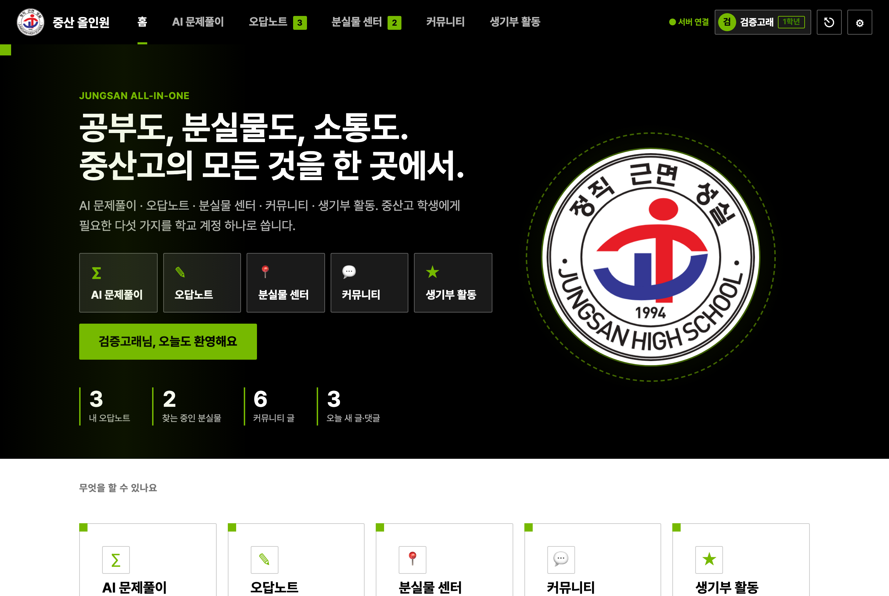
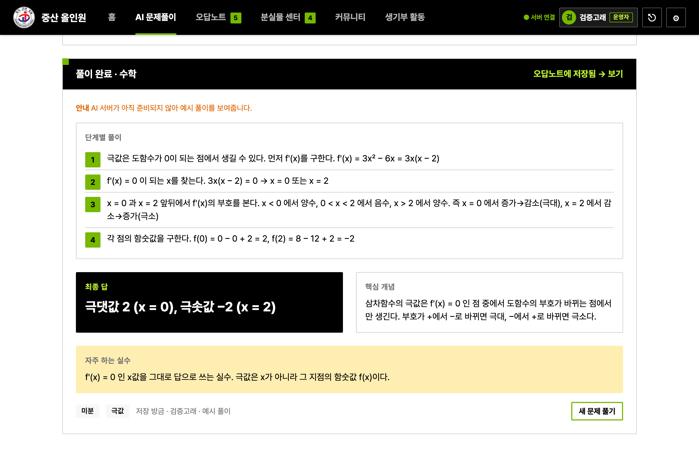
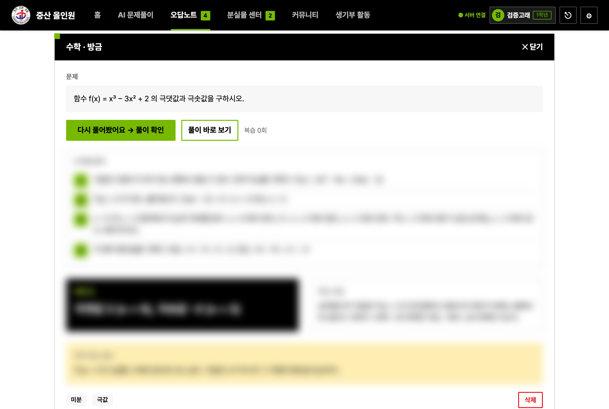
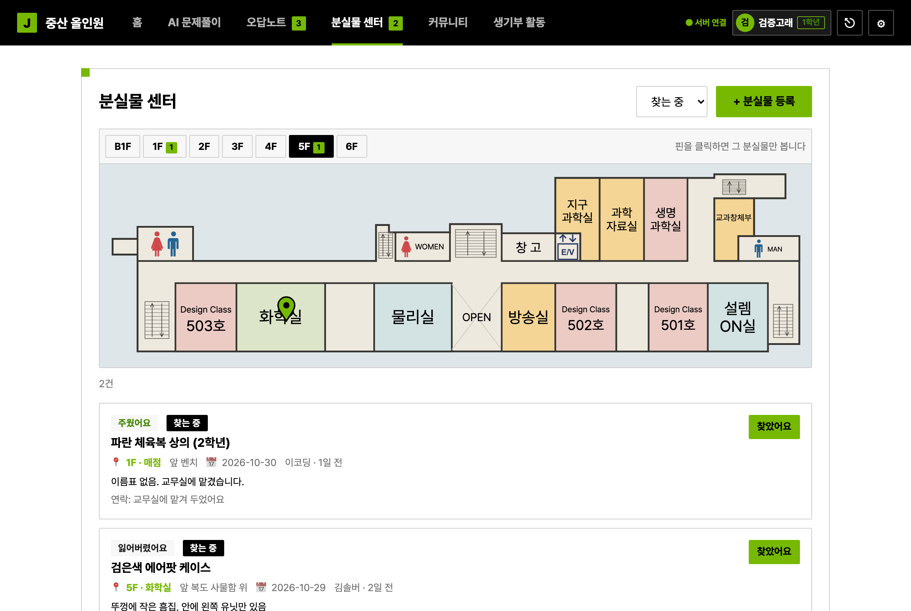
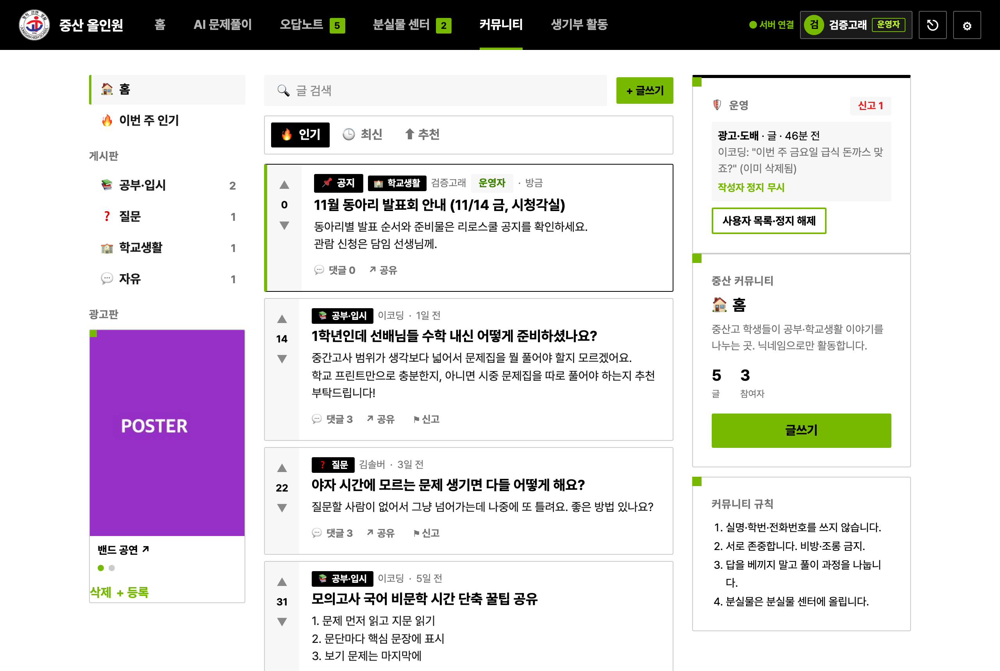
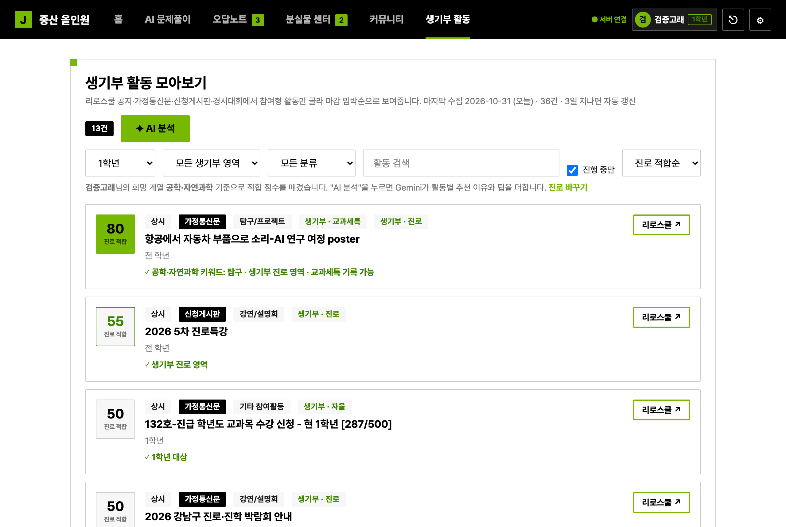

# [innovators] 중산 올인원

> 한 줄 소개: 중산고 학생이 학교 계정 하나로 쓰는 올인원 사이트 — 모르는 문제는 AI가 풀어 오답노트에 쌓아 주고, 분실물은 학교 지도에 핀으로 찾고, 커뮤니티에서 공부 이야기를 나누며, 내 진로에 맞는 생기부 활동을 추천받는다.

<!--
━━━━━━━━━━━━━━━━━━━━━━━━━━━━━━━━━━━━━━━━━━━━━━━━━━━━━━━━━━━━━
중산 솔버톤 README 작성 안내
(이렇게 <!- - - -> 로 감싼 안내문은 GitHub 화면에 보이지 않습니다. 다 쓰고 지워도 됩니다.)

■ 마감
  - 10:00까지  1~3절(기획서) 작성 → 첫 커밋  예) docs: 기획서 작성
  - 15:30까지  4~8절 완성 → 최종 커밋  (15:30 이후 커밋은 평가하지 않음)

■ 꼭 지킬 것
  - 실명·학번·전화번호를 쓰지 않습니다. 팀원은 GitHub 아이디로만 적습니다.
  - API 키·비밀번호를 저장소에 올리지 않습니다.
  - 1시간에 1번 이상 커밋합니다. 커밋 기록이 설계·과정 평가의 근거입니다.
━━━━━━━━━━━━━━━━━━━━━━━━━━━━━━━━━━━━━━━━━━━━━━━━━━━━━━━━━━━━━
-->

## 1. 문제

**문제 한 문장:** 중산고 학생은 야자·주말에 혼자 공부하다 문제에 막혔을 때 바로 물어볼 사람이 없어 그냥 넘어가고, 무엇을 틀렸는지 기록도 남지 않아 같은 유형을 반복해서 틀린다.

**상황:**
- 야자 시간이나 주말에는 질문할 선생님·친구가 옆에 없다. 해설지를 봐도 중간 과정이 생략되어 이해가 안 된다.
- 단톡에 문제 사진을 올려도 밤에는 답이 늦게 오거나 안 온다. 결국 그 문제는 넘어가고 어디에도 기록되지 않는다.
- 같은 학교 안에서도 소식과 물건이 흩어져 있다. 분실물은 학년 단톡에만 올라가 다른 학년 물건은 못 찾고, 리로스쿨에는 하루에도 여러 글이 올라와 생기부에 도움되는 활동을 놓치며, 공부나 입시정보를 나눌 학교 안 커뮤니티가 없다.

**근거:**
- 주변 학생 3명에게 물어본 결과
  - 1학년 학생 A: 이미 1학년을 경험해본 선배님들에게 질문하고 싶은데 친한 사람이 없어서 고민이에요ㅠㅠ
  - 2학년 학생 B: 학교에서 물건을 잘 잃어 버리고 또 찾기도 하는데 분실물을 처리하는 과정이 좀더 편리하게 바뀌면 좋겠어요
  - 3학년 학생 C: 혼자 공부하면서 모르는 문제가 생겼을때 걸리는 시간이 너무 길어요 질문하고 싶어요 !!

## 2. 해결

**핵심 시나리오:** 고2 김솔버가 학교 구글 계정으로 로그인 → 이메일 주소에서 학년·반이 자동 설정되고 닉네임·희망 계열을 고름 → 야자 중 막힌 수학 문제를 입력하고 "AI 풀이" → 단계별 풀이·최종 답·핵심 개념·자주 하는 실수를 보고, 결과가 오답노트에 자동 저장됨 → 며칠 뒤 오답노트에서 풀이를 가리고 "다시 풀기"로 복습 → 두고 온 이어폰을 분실물 센터의 층별 지도에 핀을 찍어 등록, 다른 학생이 "찾았어요" → 커뮤니티 "질문" 게시판에 글을 올리고 선배의 답글에 추천 → 생기부 활동 탭에서 내 희망 계열 기준 추천 활동과 AI 분석 확인

| 구분 | 기능 |
| --- | --- |
| 필수 (15:30까지 반드시) | ① 문제 텍스트 입력 → AI 단계별 풀이 (Gemini, 키는 서버 환경변수에만) ② 풀이 결과를 오답노트에 자동 저장 + 과목/태그별 목록 ③ 오답노트 상세·"다시 풀기"(풀이 가리기)·삭제 ④ 분실물 신고센터: 층별 지도에 핀 찍어 등록 / 층별 핀 지도 / "찾았어요" 처리 |
| 선택 (시간이 남으면) | 문제 사진 업로드 → 이미지 인식 후 풀이 · 커뮤니티(Reddit 구조: 게시판·투표·대댓글·공유 링크) · 학교 구글 계정 로그인(이메일 규칙으로 학년·반 자동 인식, 첫 로그인 초기 설정) · 공유 서버(Express + Firestore)로 글·분실물·오답노트 영구 저장 · 생기부 활동 탭(마감 임박순·학년·영역 필터, 희망 계열별 진로 적합 점수, AI 분석) · 홈(실시간 숫자·최근 글·오늘의 할 일) · 잠든 서버 자동 깨우기 · 신고(글·댓글·분실물)·사용자 차단·운영자(환경변수 지정: 삭제·정지·신고 처리) |
| 제외 (오늘 하지 않음) | OAuth 앱 게시(지금은 등록된 테스트 사용자만 로그인) · 리로스쿨 실시간 크롤링 서버(해외 IP 차단으로 불가, 맥에서 3일마다 수집) · 푸시 알림 · 오답노트 통계 · 화면에서 운영자 지정 |

**완성 여부 (15:30 기준)**
- [x] 필수 1: 텍스트 문제 → AI 풀이 결과 표시 (배포 서버의 Gemini로 확인)
- [x] 필수 2: 풀이 → 오답노트 자동 저장, 목록·필터 동작
- [x] 필수 3: 오답노트 상세 / 다시 풀기 / 삭제 동작
- [x] 필수 4: 분실물 지도 핀 등록 / 핀 지도 / 찾았어요 동작
- [x] GitHub Pages 배포 링크에서 위 4개 동작 (서버 연결 상태로)
- [x] 선택: 커뮤니티 / 학교 계정 로그인 / 공유 서버(Firestore) / 생기부 활동 탭·진로 점수 / 홈 / 신고·차단·운영자
- [ ] 선택: 사진 문제 풀이 — 구현·사진 축소 동작 확인, 배포 서버에서 사진 인식은 발표 전 확인

## 3. 설계

**화면 흐름:** 홈(히어로·숫자·기능 카드·최근 글) → [AI 문제풀이] 입력 → 풀이 결과 → [오답노트] 목록 → 상세(다시 풀기) / [분실물 센터] 층별 지도+목록 → 등록(지도에 핀) → 찾았어요 / [커뮤니티] 피드(게시판·정렬) → 글 상세(투표·대댓글) → 글쓰기 / [생기부 활동] 목록(진로 적합순) → AI 분석 / (우상단) 학교 계정 로그인 → 초기 설정(닉네임·희망 계열·기본 과목) → 설정(내 계정)

**데이터 구조:** (서버 → Firestore 컬렉션. 서비스 계정이 없으면 `server/db.json`, 서버가 없으면 브라우저 localStorage에 같은 구조로 저장)

```
profiles: email, role(student|teacher), entryYear, grade, klass, number, nickname, subject, track(희망 계열), major, setupDone, blocked[](내가 숨긴 닉네임), banned(운영자 정지)
reports:  id, createdAt, targetType(posts|comments|lost), targetId, reason, detail, reporter, status(open|resolved), snapshot
sessions: token → email
posts:    id, createdAt, author, authorTag, community(study|qna|school|free), title, body, score(서버가 투표 합으로 계산)
comments: id, postId, parentId(대댓글), createdAt, author, body, score
votes:    닉네임 → { 글/댓글 id: +1 | -1 }
lost:     id, createdAt, author, item, kind(lost|found), floor, x, y(지도 SVG 좌표), room, place, date, desc, contact, status(finding|found)
notes:    id, createdAt, author, subject, tags[], question, imageDataUrl, steps[], answer, concept, pitfall, reviewCount, lastReviewed, source(ai|fallback|seed), model  ※ 본인만 조회
analysis: 계열|학과 → { at, model, items[{id, score, recommend, reason, tip}] }  (생기부 AI 분석 캐시, 24시간)
```

**기술 선택:**
- 선택: 프론트는 HTML + CSS + 바닐라 JS(빌드 없음, GitHub Pages). 서버는 Express 한 파일(Render 무료) + Firestore(Firebase Admin, 서비스 계정은 서버 비밀 파일). AI는 서버가 Gemini를 대신 호출하되 무료 플랜에서 되는 모델(gemini-3.5-flash-lite 등)을 자동으로 고름. 로그인은 Google Identity Services + 학교 이메일 규칙(입학년도-학번@jungsan.hs.kr → 학년·반·번호, 영문 포함 → 교사)으로 역할 자동 인식, 토큰 검증은 서버에서. 지도는 팀이 오늘 그린 층별 안내도 SVG에서 벡터만 추출(80KB). 디자인은 NVIDIA DESIGN.md 토큰(검정 프레임·흰 캔버스·녹색 액센트·2px 모서리).
  이유: 빌드·네이티브 모듈이 없어 설치와 배포가 실패할 여지가 적다. API 키·서비스 계정은 서버 환경변수에만 있어 공개 저장소에 비밀값이 없다. 서버가 잠들거나 죽어도 프론트가 "서버 깨우는 중" → 로컬 모드로 자동 전환되어 발표가 멈추지 않는다.
- 고르지 않은 안과 이유: React 등 프레임워크(빌드·충돌 부담), 프론트에서 Firebase/Supabase 직접 호출(설정값이 저장소에 들어가 "키 금지" 규칙과 충돌 → 서버 경유로만 사용), DeepSeek API(텍스트 전용이라 사진 문제 불가), SQLite(네이티브 빌드 실패 위험), Netlify Functions(함수 10초 제한이 AI 응답 시간보다 짧음), GitHub Actions로 리로스쿨 수집(해외 IP 차단).
- 막히면: AI 호출 실패 → 다른 모델 재시도 → 예시 풀이. 서버 응답 없음 → 깨우기 재시도 → 로컬 모드. 구글 로그인이 막히면 → 서버 스위치(`ALLOW_DEMO_LOGIN=1`)로 같은 규칙의 이메일 입력 로그인. Pages 반영 지연 → `python3 -m http.server`로 로컬 시연.

**파일 구조 (역할 분담 단위):**

```
index.html         레이아웃·탭·모달(설정/로그인/초기 설정)
css/style.css      NVIDIA DESIGN.md 기반 토큰(검정 프레임·흰 캔버스·녹색 액센트·2px 모서리)
js/app.js          Store(localStorage+서버 전달), 라우팅(#탭/하위), 설정, 시드
js/api.js          서버 연동(헬스체크, 당겨오기 8초, 쓰기 전달, 로그인, AI 프록시)
js/auth.js         이메일 규칙 파싱, Google 로그인, 초기 설정, 상단 계정 표시
js/solver.js       AI 풀이 입력·사진 축소·결과 렌더·오답노트 저장
js/notes.js        오답노트 목록/상세/다시 풀기
js/floors.js       층별 지도 벡터 데이터   js/map.js  지도 컴포넌트(핀 찍기/표시)
js/lost.js         분실물 센터            js/community.js  커뮤니티(Reddit 구조)
js/home.js         홈(히어로·카운트업·스크롤 등장·오늘의 할 일)   js/activities.js  생기부 활동 탭(진로 적합 점수·AI 분석, 오늘 작성)
server/index.js    Express API(컬렉션·로그인·투표 점수·Gemini 프록시·활동 AI 분석·Firestore 저장)
assets/            학교 교표(emblem.png)와 크기별 아이콘
data/seed.json     데모 데이터   data/config.json  서버 주소   data/activities.json  생기부 활동 목록(교사 실명 제거)
tools/riro-notifier/  리로스쿨 활동 수집 도구 — 팀원이 만든 도구를 데이터 출처로 사용. auto_update.py 가 3일마다 수집→정제→push
.github/workflows/ 서버 깨우기(10분), 수집 워크플로(수동 전용)
docs/PLAN.md       개발 계획   docs/img/  실행 화면
```

## 4. 실행 링크·실행 방법

- **실행 링크(웹):** https://nesewr.github.io/solvathon-innovators/
- **서버(API):** https://solvathon-innovators.onrender.com/api/health — `"ok":true` 이면 정상. 무료 서버라 잠들어 있으면 첫 접속에 30~60초 걸리며, 그동안 화면 오른쪽 위에 "서버 깨우는 중…"이 표시된다.
- **로그인:** 학교 구글 계정(@jungsan.hs.kr)으로만 로그인된다. 심사용 계정이 없으면 서버 환경변수 `ALLOW_DEMO_LOGIN=1`일 때 이메일 직접 입력(예: `26-10302@jungsan.hs.kr`, 가짜 학번)으로 들어갈 수 있다.
- **로컬 실행:**

```bash
# 프론트 (정적)
python3 -m http.server 8765        # 저장소 루트에서 → http://localhost:8765
# 서버 (선택)
cd server && npm install && cp .env.example .env   # .env 에 GEMINI_API_KEY 등 입력
npm start                                           # http://localhost:8787
```

서버 없이 프론트만 띄우면 자동으로 "로컬 모드"(브라우저 저장)로 동작하고, 데모 데이터(`data/seed.json`)가 들어간다.

## 5. 실행 화면

핵심 시나리오 순서대로. (로컬 데모 계정 "검증고래"로 캡처, 가짜 데이터)

**① 홈 — 다섯 기능을 한 화면에서, 로그인하면 닉네임만 표시**


**② AI 문제풀이 — 단계별 풀이 · 최종 답 · 핵심 개념 · 자주 하는 실수, 결과는 오답노트에 자동 저장**


**③ 오답노트 — 풀이를 가리고 "다시 풀어봤어요"로 복습 횟수 기록**


**④ 분실물 센터 — 층별 학교 지도에 핀으로 위치 표시, 핀을 누르면 그 물건만**


**⑤ 커뮤니티 — 게시판·추천·대댓글 (Reddit 구조)**


**⑥ 생기부 활동 — 희망 계열(컴퓨터·SW) 기준 진로 적합 점수, "AI 분석" 버튼으로 추천 이유·팁 추가**


## 6. AI 활용

| 단계 | 도구 | 어떻게 썼나 |
| --- | --- | --- |
| 기획 | Claude Code (Claude Fable 5.1) | 대회 안내 페이지를 분석해 배점·규칙·시간표를 정리하고, 기능을 필수/선택/제외로 나누는 README 1~3절 초안과 `docs/PLAN.md`(시간표·데모 대본) 작성 |
| 디자인 | Claude Code + NVIDIA DESIGN.md | getdesign.md의 NVIDIA 디자인 문서를 읽어 색·간격·모서리 토큰을 CSS 변수로 옮기고, 커뮤니티는 Reddit 레이아웃을 참고해 3단 구성 |
| 코드 작성 | Claude Code | 프론트(HTML/CSS/JS 11개 파일)와 서버(Express 1파일), Firestore 연동, 지도 핀 컴포넌트, 진로 적합 점수 로직을 대화로 요청하고 생성. 매 기능마다 로컬 브라우저에서 자동 점검 후 커밋 |
| 오류 해결 | Claude Code | 모듈 초기화 오류, 브라우저 캐시로 설정이 안 바뀌던 문제, Gemini 무료 플랜의 구모델 404·과부하 503, 재배포 시 데이터 초기화(→ Firestore), 리로스쿨 해외 IP 차단(→ 맥 launchd) 등을 로그를 보며 함께 해결 |
| 서비스 안의 AI | Google Gemini (gemini-3.5-flash-lite 등, 서버 경유) | 문제 풀이(단계·답·개념·실수), 생기부 활동의 진로별 추천 이유·팁 생성 |

**효과적이었던 요청:**

```
지도에 정확히 핀으로 찍어서 표시하게 해
```
```
설정한 진로에 따라서 활동 점수 매기게 해
```
```
분석 버튼은 어디감  → 원래 도구의 AI 판정 기능을 "AI 분석" 버튼으로 되살리는 계기
```

**AI 결과에서 직접 고친 부분:**
- AI가 제안한 "데모 계정 전환 + 브라우저 저장" 구조를 버리고 **학교 계정 로그인 + 공유 서버 + Firestore**로 바꾸도록 방향을 정함 (실제 서비스처럼 돌게 하자는 결정)
- 설정 화면에 API 키·서버 주소가 노출되는 설계를 지적해 **내부 설정을 개발자 전용(?dev=1)으로 분리**
- 홈 히어로가 AI 풀이만 강조하던 것을 **다섯 기능 동등 구성**으로 수정, 히어로를 전체 폭으로, 교표를 실제 학교 교표로 교체, 교표의 상하 움직임은 빼 달라고 지시
- 리로스쿨 수집 도구를 저장소에 넣을지, 출처를 어떻게 적을지 결정
- Gemini 모델 선택: 무료 플랜에서 되는 모델을 서버가 자동으로 고르게 하자는 방향 결정

## 7. 역할

| GitHub 아이디 | 맡은 일 | 주요 파일 |
| --- | --- | --- |
| Nesewr | 기획·전체 설계, AI 도구로 프론트·서버 구현 지휘, Render·Firebase·Google OAuth 설정, 배포·검증 | index.html, js/*, server/index.js, data/config.json |
| rlazmq | 학교 층별 안내도 제작(분실물 지도의 벡터 도면),아이디어 제시, README 4·7절 작성 | js/floors.js(도면 데이터), README.md |
| jaehyun5471-del | 리로스쿨 활동 수집 도구 개발·데이터 정리, 인터뷰 근거 수집, 테스트 | tools/riro-notifier/, data/activities.json |

## 8. 한계와 다음 계획

**한계:**
- Google 로그인은 OAuth 앱이 "테스트" 상태라 등록된 테스트 사용자(최대 100명)만 가능하다. 전교생이 쓰려면 앱 게시(검증) 절차가 필요하다.
- Gemini 무료 플랜이라 호출이 몰리면 503으로 실패할 수 있다. 서버가 다른 모델로 재시도하고, 그래도 안 되면 예시 풀이로 대체한다.
- 생기부 활동 데이터는 리로스쿨이 해외 IP를 막아 공용 서버에서 수집할 수 없다. 팀원 맥에서 3일마다 본인 계정으로 수집해 push하는 방식이라 그 맥이 꺼져 있으면 갱신이 늦어진다.
- 무료 서버(Render)는 15분 쉬면 잠든다. 10분마다 깨우는 워크플로를 두었지만 첫 접속이 느릴 수 있다.
- 운영자는 서버 환경변수 `ADMIN_EMAILS`로만 지정한다. 화면에서 운영자를 추가하는 기능은 없다.
- 오답노트 사진은 1024px로 줄여 저장하지만 Firestore 문서 1MB 제한을 넘으면 사진이 빠진다.

**다음 계획:**
1. OAuth 앱 게시 + 학교 워크스페이스 관리자 승인 → 전교생 로그인
2. 운영자 기능 확장: 공지 고정, 신고 통계, 정지 기간 설정
3. 오답노트 복습 알림(3일·7일 간격)과 과목별 통계 카드
4. 생기부 활동 수집을 학교 내부 서버(한국 IP)로 옮겨 자동화
